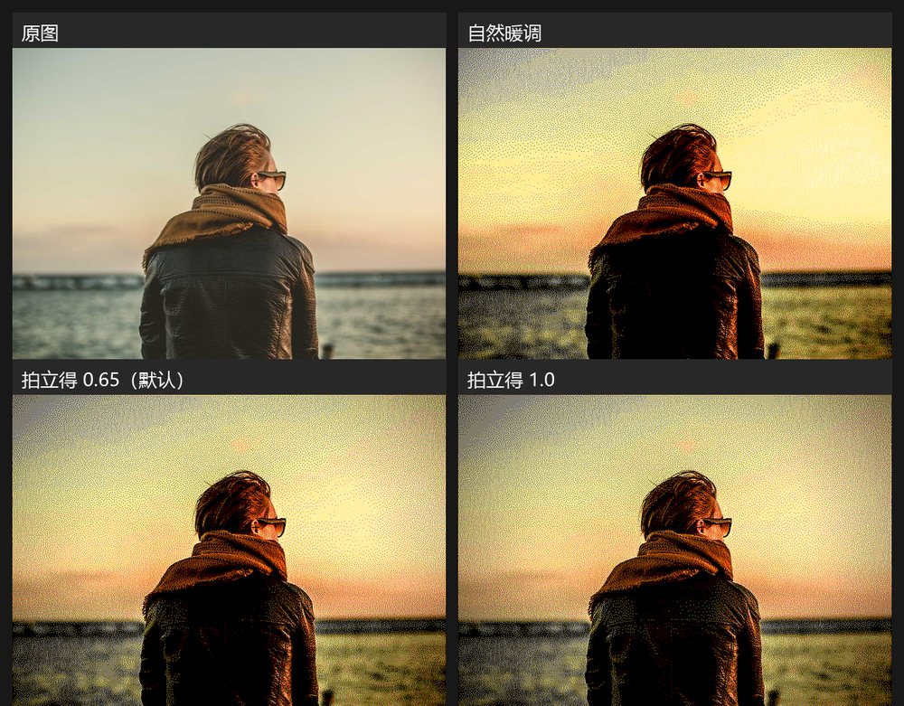

# 拍立得外观（instant-film look）调研与实现

## 结论

- **直接套整条 3D LUT 不适合四色墨水屏**。实测 Film-Luts 的 Polaroid PX-70 / 690 等 LUT 后，中间调会强烈偏黄，天空和皮肤“黄爆”，黄色通道被占满；抬黑位又会让暗部抖动变脏。
- 最终采用**参数化外观层**：fade 曲线 + 分离色调 + 轻暗角，强度可调。默认强度 0.65，观感接近褪色的即时胶片，又不破坏四色屏的干净度。
- 管线位置：`warmMap` → `applyInstantLook` → `quantize`。`warmMap` / `quantize` 的逐字冻结实现没有改动。

上图从左到右、从上到下：原图、自然暖调（强度 0）、拍立得 0.65（默认）、拍立得 1.0。测试条件为 768×552、std 调色板、Floyd–Steinberg 抖动 0.85。

## 为什么不用整条 LUT

测试对象是 [YahiaAngelo/Film-Luts](https://github.com/YahiaAngelo/Film-Luts)（MIT）里的 `polaroid_px-70.cube`、`polaroid_690.cube` 等，13³ 的 `.cube`，约 128KB/个。结论：

| 用法 | 结果 |
| --- | --- |
| PX-70 直接套 | 中间调大幅偏黄，天空变奶油黄，皮肤失去层次；四色里几乎全是黄 + 白 |
| 690 直接套 | 暗部抬升、轻微品红，观感最接近拍立得；但暗部噪点明显，天空偏粉 |
| 690 @ 30% + natural | 可用，但和参数化层相比没有明显优势，还多一次 3D 插值开销 |
| LUT + 线性输入 | 几乎全黑，说明这批 `.cube` 是按 sRGB 输入生成的，不能当线性 LUT 用 |

原因很直接：四色屏只有黑 / 白 / 黄 / 红四个输出，3D LUT 里细微的色相偏移大部分会被量化吃掉，剩下的主要是“整片偏黄”和“黑位抬升”。黑位抬升在四色屏上会变成更粗的抖动噪点，而不是胶片那种细腻的灰。

## 最终算法

`applyInstantLook(buf, w, h, strength)` 在 `warmMap` 之后、`quantize` 之前执行，逐像素做三件事，最后按 `strength` 与原图混合：

1. **Fade 曲线**：`c = 18 + (242 - 18) * (v/255)^0.92`
   - 黑位从 0 抬到 18，高光压到 242，中间调略微提亮。
2. **分离色调**：按亮度 `t` 给暗部加青、亮部加暖
   - 暗部：`r -= 7*sh, g += 2*sh, b += 7*sh`
   - 亮部：`r += 9*hi, g += 3*hi, b -= 9*hi`
   - `sh = (1-t)² * 0.70`，`hi = t² * 0.70`
3. **轻暗角**：径向 `smoothstep`，边缘最多压暗 18%。

混合：`out = v + (look(v) - v) * strength`。强度 0 与“自然暖调”逐像素一致，强度 1 是完整的 classic 档。

### 参数

| 参数 | 值 | 作用 |
| --- | --- | --- |
| `fade` | 18 | 黑位抬升 |
| `white` | 242 | 高光压缩 |
| `gamma` | 0.92 | 中间调提亮 |
| `tint` | 0.70 | 分离色调强度 |
| `vignette` | 0.18 | 暗角强度 |
| `strength` | 0.65 | 页面滑杆“胶片强度”，0–1 |

### 性能

初版每像素 3 次 `Math.pow`，768×552 全尺寸约 **386ms**。改成 256 级曲线 / 分离色调 LUT，并把暗角与混合内联后，降到约 **87ms**（Node 22，本机）；预览尺寸约 276×384 时约 22ms。曲线 LUT 的 8 位取整只会改变抖动相位，肉眼观感与浮点版一致。

## 开源方案调研

| 项目 | 许可证 | 内容 | 是否采用 |
| --- | --- | --- | --- |
| [YahiaAngelo/Film-Luts](https://github.com/YahiaAngelo/Film-Luts) | MIT | 598 个 13³ `.cube`，含 Polaroid 664/667/669/690/PX-70/PX-680/Time Zero | 用于调研与对比，未嵌入 |
| [G'MIC](https://github.com/GreycLab/gmic) / [gmic-community](https://github.com/GreycLab/gmic-community) | GPL-3.0 | 上述 LUT 集合的生态与滤镜框架 | 许可证与本项目 GPL-3.0 兼容；未直接移植代码 |
| [JanLohse/spectral_film_lut](https://github.com/JanLohse/spectral_film_lut) | MIT | 从胶片 datasheet 生成 LUT | 未采用：没有拍立得片基，且生成流程偏重 |
| [una/CSSgram](https://github.com/una/CSSgram) | MIT | Instagram 风格 CSS 滤镜 | 未采用：依赖整套库，且不是胶片模型 |
| [evanw/glfx.js](https://github.com/evanw/glfx.js) | MIT | WebGL 滤镜原语（暗角、色调等） | 未采用：为四个 2D 操作引入 WebGL 不划算 |

> 许可证说明：Film-Luts 的 README 声明不拥有底层 LUT 数值的版权；其生态上游 G'MIC 是 GPL-3.0，与本项目一致。当前实现没有复制任何 LUT 数据，只借鉴了“褪色 + 暖高光 + 冷暗部”的观感，因此不引入额外许可证义务。若以后要嵌入 `.cube` 数据，建议同时保留 Film-Luts 与 G'MIC 的 attribution。

## 调参建议

- **强度 0.5–0.7 最稳**；超过 0.85 后暗部噪点会明显变粗（四色抖动的固有限制）。
- 想更“旧”：`fade` 22–26、`white` 236–240、`tint` 0.9；注意黄色通道会更快饱和。
- 想更“干净”：强度 0.4–0.5、`vignette` 0.10。
- **不建议加颗粒**：和 Floyd–Steinberg 抖动叠加会变脏；如果一定要加，幅度控制在 ±3/255 以内。
- 白边和日期戳不需要改算法：用现有“留白”+ 文字对象即可。552×768 下经典拍立得比例约为上/左/右 90、下 210。

## 构建注意（Windows）

- 本项目在 **纯 ASCII 路径**下编译通过；如果源码路径含中文（例如 `D:\...\墨水屏\...`），ESP-IDF / CMake 可能只打印 `Reading CMake configuration...` 然后静默 `FAILED`。遇到时把源码复制到 `C:\...\moink-build` 之类的纯英文路径再编译。
- 平台已锁定 `espressif32@7.1.3`，与 `legacy_ref/build_log.txt` 里的构建版本一致。
- 实测 app 体积 1,171,202 字节，占 1,310,720 字节 OTA 槽的 89.4%。

## 验证

- 页面内实测：强度 0 与“自然暖调”逐像素一致；0.65 / 1.0 会改变四色占比；风格按钮、滑杆、提示文案正常。
- `node tools/smoke_page.js`：2 个失败为 R1.5.8 基线已有（裁剪卡显隐、加字开关），与本改动无关。
- `python tools/check_algo.py`：本地缺少 M7 参考页，SKIP；`warmMap` / `quantize` 未改动。
- `page/index.html` 已重新固化到 `src/index_html.h`，页面 meta 与 `src/version.h` 均为 R1.5.8。
